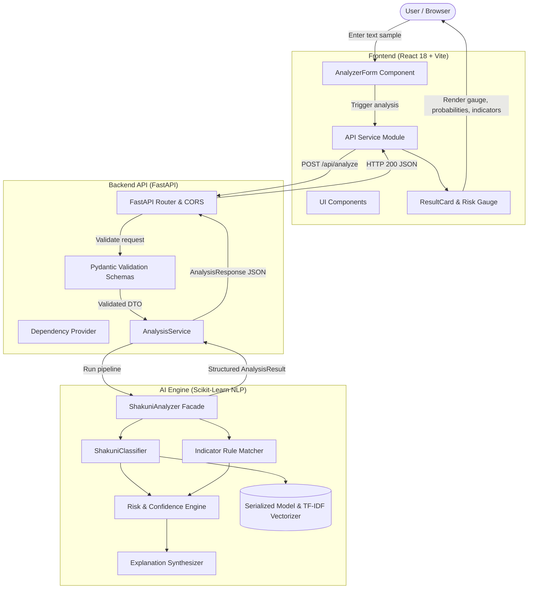

# Shakuni System Architecture

## Architectural Overview

Shakuni is engineered as a decoupled, layered full-stack application designed specifically for natural language analysis of strategic deception and manipulative communication patterns.

## Detailed Component Breakdown

### 1. Frontend Layer (`frontend/`)
- **Framework**: React 18, React Router v6, Vite build tool.
- **Styling & Aesthetics**: Light editorial research design system with CSS custom properties (`var(--...)`), editorial serif headings (`Playfair Display`), clean geometric UI sans (`Plus Jakarta Sans`), monospace data accents (`JetBrains Mono`), and a warm ivory, deep charcoal, deep burgundy, and antique gold palette.
- **Pages**:
  - `Home.jsx` (`/`): Editorial asymmetric landing experience with pattern spotlights, live mini-evaluator, system metrics, and mission statement.
  - `Analyze.jsx` (`/analyze`): Interactive analysis workbench with live input, preset scenario pills, real-time indicator detection, session history, and structured audit reports.
  - `Patterns.jsx` (`/patterns`): Complete 7-category tactical taxonomy breakdown with game-theoretic explanations, linguistic markers, detection criteria, and representative citations.
  - `Research.jsx` (`/research`): Theoretical foundations exploring asymmetric information theory, rhetorical coercion, bounded rationality, and referenced academic literature.
  - `Model.jsx` (`/model`, `/methodology`): Transparent AI methodology detailing sublinear TF-IDF extraction, multinomial logistic calibration, composite risk formulation, and empirical confusion matrix benchmarks.
  - `About.jsx` (`/about`): Academic monograph outlining project origins, ethical guidelines, architecture overview, and research boundaries.
  - `NotFound.jsx` (`*`): Editorial 404 page for handling unmapped routes.
- **Core Components**:
  - `AnalyzerForm.jsx`: Text input workbench, character and word counters, scenario preset selector, and analysis submission handling.
  - `ResultCard.jsx`: Multi-panel intelligence brief presenting primary classification, confidence rating, composite risk spectrum, linguistic evidence chips, posterior probability distribution, and contextual narrative explanations.
  - `RiskIndicator.jsx`: Linear segmented threat spectrum meter mapping composite scores (0–100) into Low, Moderate, or High risk tiers with needle position and descriptive severity.
  - `CategoryBadge.jsx`: Dynamic visual badge reflecting category iconography and palette-harmonized color coding.
  - `AnalysisHistory.jsx`: Collapsible session drawer for reviewing previous evaluations during the current session.
  - `EmptyWorkspace.jsx`: Editorial placeholder state presenting sample prompts and usage guidance when no text has been submitted.
  - `LoadingState.jsx`: Multi-stage animated execution progress indicating tokenization, vectorization, classification, and indicator matching steps.
  - `Navbar.jsx`: Global header featuring strategic dice logo, route navigation links, and live backend connectivity status pill.
  - `Footer.jsx`: Academic footer with ethical disclaimers, framework navigation, and institutional attribution.

### 2. Backend API Layer (`backend/app/`)
- **Framework**: FastAPI with asynchronous route handlers.
- **Configuration**: `Settings` class loading variables from `.env` (CORS origins, payload caps, debug toggles).
- **Validation**: Pydantic v2 schemas (`AnalysisRequest`, `BatchAnalysisRequest`, `AnalysisResponse`, `CategoriesResponse`, `HealthResponse`).
- **Error Handling**: Custom exception handlers with standard JSON envelopes.

### 3. AI / NLP Engine (`ai_engine/`)
- **Centralized Taxonomy** (`classifier/categories.py`): Single source of truth for all 7 manipulation categories, descriptions, typical indicators, and baseline risk weights.
- **Feature Extraction & Classification** (`classifier/classifier.py`): Text normalization, unigram/bigram TF-IDF vectorization, and multinomial logistic regression inference.
- **Linguistic Marker Extraction** (`analysis/indicators.py`): Rule-based pattern matcher identifying rhetorical strategies (e.g. false dichotomies, conformity demands, manufactured urgency).
- **Risk & Confidence Calculation** (`analysis/risk_score.py`, `analysis/confidence.py`): Mathematical scoring model combining model posterior probabilities, category base severity, and indicator density into a normalized 0–100 index.
- **Explanation Generator** (`analysis/explanation.py`): Human-readable synthesis citing specific linguistic evidence while enforcing non-absolute, probabilistic framing.
